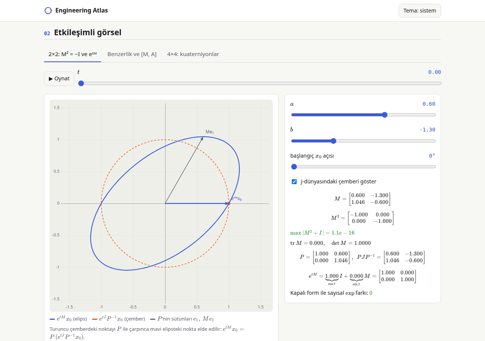
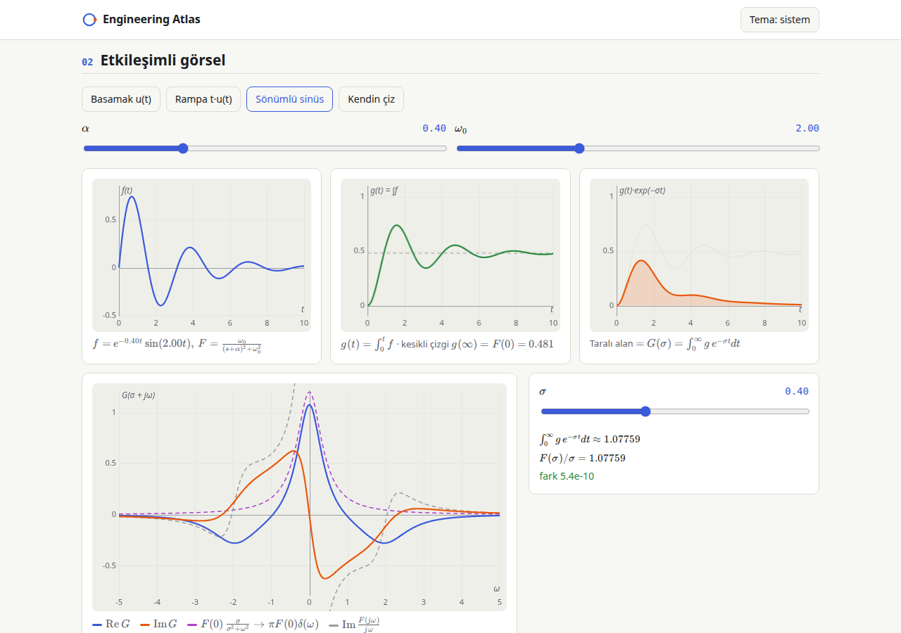

# Engineering Atlas

**Live:** https://writerforight.github.io/engineering-atlas/

Interactive visualisations of engineering and mathematics concepts. Static site
(Vite + React + TypeScript + KaTeX), deployed to GitHub Pages. The UI is in
Turkish; code, comments and commits are in English.

Every topic page follows the same order:

1. **Sezgi** — short intuition
2. **Etkileşimli görsel** — the interactive part
3. **Adım adım türetme** — derivation from first principles; every step says where its formula comes from
4. **Yorum ve genelleme** — interpretation and generalisations

> The repo name `engineering-atlas` is only a default. The build uses a relative
> base path and hash routing, so renaming the repo (or using a custom domain)
> needs no code change.




## Topics

Click to jump straight in:

- **M² = −I and e^{tM}**: [2×2 family (incl. skew-symmetric ±J)](https://writerforight.github.io/engineering-atlas/#/topic/complex-structure?tab=structure&section=etkilesim) · [similarity and commutator \[M, A\]](https://writerforight.github.io/engineering-atlas/#/topic/complex-structure?tab=similarity&section=etkilesim) · [4×4 quaternions (skew-symmetric M)](https://writerforight.github.io/engineering-atlas/#/topic/complex-structure?tab=quaternion&section=etkilesim) · [derivation](https://writerforight.github.io/engineering-atlas/#/topic/complex-structure?section=turetme)
- **Skew-symmetric matrix [ω]× and its powers**: [draw a vector ω, pick a power k, watch [ω]×ᵏ bend 3D space](https://writerforight.github.io/engineering-atlas/#/topic/skew-symmetric?section=etkilesim) · [derivation](https://writerforight.github.io/engineering-atlas/#/topic/skew-symmetric?section=turetme)
- **Laplace of an integral, F(s)/s**: [interactive](https://writerforight.github.io/engineering-atlas/#/topic/laplace-integration?section=etkilesim) · [derivation](https://writerforight.github.io/engineering-atlas/#/topic/laplace-integration?section=turetme)

Deep links: `#/topic/<slug>?tab=<tab>&section=<sezgi|etkilesim|turetme|yorum>`. The tab in the URL
updates as you switch tabs, so the address bar is always a shareable link to the current view.

| Slug | What it shows |
| --- | --- |
| `complex-structure` | Real 2×2 matrices with M² = −I, `e^{tM} = cos t I + sin t M`, elliptic orbits as `P e^{tJ} P⁻¹`, the similarity flow `e^{tM} A e^{−tM}` and `[M, A]`, and the 4×4 quaternion case (a whole S² of complex structures). |
| `skew-symmetric` | Type any ω ∈ R³: its cross-product matrix [ω]×, the powers [ω]×ᵏ (cycle via [ω]׳ = −\|ω\|²[ω]×), and a 3D lattice morphing from I to [ω]×ᵏ: ω is crushed, space flattens onto the plane ⊥ ω and turns 90° per power. Drag the tip of ω to draw it. |
| `laplace-integration` | `L{∫f} = F(s)/s`, the damped integrand `g(t)e^{−σt}`, the σ → 0 limit `1/(jω) + πF(0)δ(ω)`, ROC warnings, causal signal vs causal system. |

## Development

```bash
npm install
npm run dev        # local dev server
npm test           # Vitest (core math + registry)
npm run build      # type-check (strict) + production build into dist/
npm run preview    # serve dist/
```

Node 22 is used in CI.

## Project layout

```
src/
  core/
    math/      pure TS, no UI: matrices, expm, complex numbers, quaternions,
               quadrature, causal test signals (+ *.test.ts)
    ui/        shared React pieces: Canvas, Slider, Tex (KaTeX), Tabs,
               Callout, Step/Steps, plot + draw helpers, theme
    topic.ts   TopicMeta / TheoryModule types
  app/         shell: hash router, home page, topic page, registry
  topics/
    _template/             copy this to start a new topic (ignored by the registry)
    complex-structure/     meta.ts · Viz.tsx · Theory.tsx
    laplace-integration/   meta.ts · Viz.tsx · Theory.tsx
```

## Adding a topic

1. Copy `src/topics/_template/` to `src/topics/<your-slug>/` (lowercase, dashes;
   folders starting with `_` are ignored).
2. Edit `meta.ts`: `title`, `summary`, `tags`, optional `order` (home-page sort key).
3. Write `Viz.tsx` with a default-exported component. Use `Canvas` with a `draw`
   callback (CSS-pixel coordinates, theme palette passed in), `Slider`, `Tex`.
4. Write `Theory.tsx` exporting `Intuition`, `Derivation` and `Notes`. Build the
   derivation from `<Steps>` / `<Step title why>`; `why` is required and must say
   where the step comes from.
5. Put any non-trivial math in `src/core/math/` and add a `*.test.ts` next to it.
6. `npm run dev`. The topic appears on the home page automatically
   (`import.meta.glob` in `src/app/registry.ts`). No other file needs editing.

## Deployment

`.github/workflows/deploy.yml` runs on every push to `main`: `npm ci` → tests →
build → deploy `dist/` to GitHub Pages. One-time setup in the repo:
**Settings → Pages → Source: GitHub Actions**.

## Roadmap

- Kalman filter
- Fourier / spectrum
- Park / Clarke transform
- Matrix exponential and state space
- NVH spectral analysis

## Assumptions

Choices made where the brief left room:

- **Routing:** hash routes (`#/topic/<slug>`) so deep links work on GitHub Pages without a 404 redirect hack; Vite `base: './'` so the site works under any repo name.
- **Theory format:** `Theory.tsx` (not MDX), so there is no MDX toolchain and formulas use the same `Tex` component as the visualisations. A theory module exports three components (`Intuition`, `Derivation`, `Notes`), so the page shell can enforce the section order.
- **`b → 0` in `complex-structure`:** b = 0 is impossible (it would need −a² = 1), so the slider value is clamped to |b| ≥ 0.05 and a warning is shown. The sign of b sets the rotation direction.
- **Conjugator:** `P = [e₁, M e₁] = [[1, a], [0, c]]` (any non-zero first column works; e₁ keeps the formula short).
- **"How much does A rotate":** A is split into `A_c = (A − MAM)/2` (commutes with M, fixed) and `A_a = (A + MAM)/2` (anticommutes, rotates as `e^{2tM} A_a`). The UI reports `‖A_a‖ / √(‖A_c‖² + ‖A_a‖²)` next to `‖[M, A]‖`.
- **Quaternion view:** basis order (1, i, j, k), M = left multiplication by the unit pure quaternion n. "2D slice" is shown two ways: projection onto a chosen coordinate plane (ellipse in general) and the invariant plane span{p₀, M p₀} (exact circle). The sphere picker drags on the front hemisphere; the θ slider reaches the back.
- **User-drawn signal:** piecewise linear on 0 ≤ t ≤ 8, zero afterwards (finite support → F is entire; its transform is computed numerically).
- **σ range:** −0.6 … 2, deliberately reaching below the ROC so the divergence warning can be seen.
- **Animation:** starts paused when the OS asks for reduced motion.
- **Theme:** follows the system by default; the header button cycles system → light → dark and the choice is stored in `localStorage`.
- **TypeScript:** pinned to 5.9 (`strict`, `noUncheckedIndexedAccess`); TS 7 was too new to rely on.

## Author

Built by [Eren Can Almaz](https://writerforight.github.io/), an Electrical Engineering (Elektrotechnik)
student at RWTH Aachen University who builds interactive tools that make engineering visible.

## License

MIT, see [LICENSE](LICENSE).
